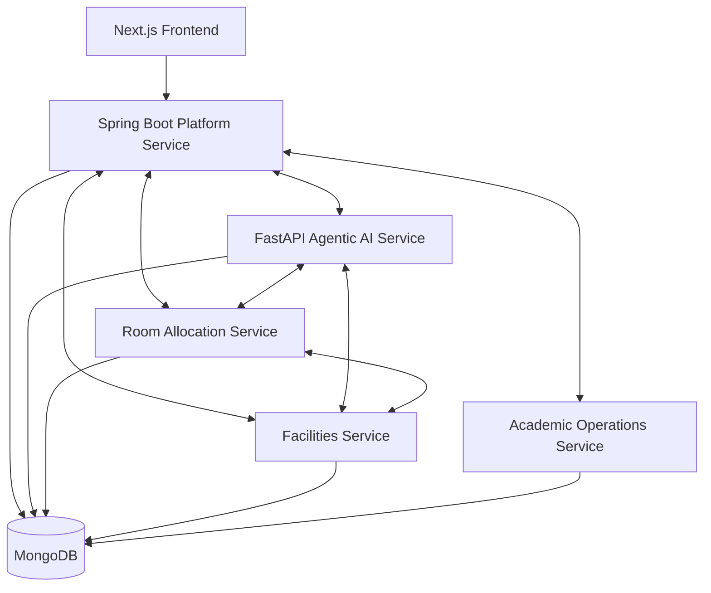

# UniSchedule AI

### Agentic AI-Driven University Timetable Recovery and Smart Campus Resource Allocation System

**University Group Project | Microservice Architecture | Agentic AI | Spring Boot | MongoDB**

## 1. Project Overview

UniSchedule AI is an intelligent university timetable recovery and campus resource management platform developed using a microservice architecture.

The main purpose of this project is to help universities manage unexpected timetable changes, identify scheduling conflicts, optimize classroom allocation, and generate intelligent recovery recommendations using Agentic Artificial Intelligence.

Traditional timetable systems mainly display scheduled lectures and available classrooms. However, when an unexpected situation occurs, such as a lecturer becoming unavailable or a laboratory closing, finding a suitable alternative can become difficult.

UniSchedule AI goes beyond normal timetable management by investigating alternative rooms, identifying possible lecture movements, checking scheduling constraints, and recommending solutions that minimize disruption to existing schedules.

The system combines:

- Spring Boot for core timetable management and conflict validation.
- Python and FastAPI for Agentic AI workflows.
- Node.js microservices for room optimization, facilities management, and academic operations.
- Next.js for the web application.
- MongoDB for data storage.
- REST APIs for communication between microservices.

The project is developed as an academic prototype. Real university timetables may be imported with faculty permission, while all timetable changes and recovery experiments will take place in a separate simulation environment.

## 2. Problem Statement

University timetables frequently face unexpected changes due to:

- Lecturer unavailability.
- Postponed lectures.
- Additional lecture sessions.
- Classroom and laboratory maintenance.
- Unavailable equipment.
- Insufficient classroom capacity.
- Overlapping lecturer or student-group schedules.
- Inefficient use of university facilities.

When these situations occur, administrators often need to manually search for alternative rooms and time slots.

A suitable empty room may not always be available, even when an alternative solution exists.

For example, a large lecture hall may be occupied by a smaller class. Moving that class to another available room could free the larger hall for a lecture requiring more seats.

Identifying these possibilities manually is time-consuming and requires checking multiple constraints.

UniSchedule AI aims to automate the investigation process and recommend valid timetable recovery solutions.

## 3. Project Objectives

The main objectives are:

1. Develop a centralized university timetable management platform.
2. Import existing faculty timetables from CSV or Excel files.
3. Detect timetable conflicts involving lecturers, student groups, rooms, and time slots.
4. Manage classrooms, laboratories, equipment, and facility restrictions.
5. Develop intelligent room allocation and optimization algorithms.
6. Implement an Agentic AI workflow capable of investigating timetable disruptions.
7. Generate multiple valid timetable recovery recommendations.
8. Support timetable simulations without modifying official university records.
9. Provide administrator approval workflows for proposed simulation changes.
10. Notify affected users of approved simulated timetable changes.
11. Develop a modular microservice architecture using Spring Boot, Node.js, Python, and MongoDB.
12. Evaluate recovery efficiency, optimization performance, and AI tool usage.

## 4. Example: Intelligent Room Reallocation

Consider the following situation.

| Resource | Current Situation |
|---|---|
| Lecture A | 40 students |
| Hall A | Capacity 80, occupied by Lecture A |
| Lecture B | 60 students, requires a room |
| Classroom B | Capacity 50, available |

A traditional timetable system searches for an empty room that can accommodate 60 students.

Since Classroom B only accommodates 50 students, the system may report that no suitable room is available.

However, UniSchedule AI investigates alternative arrangements.

### Proposed recovery

Step 1: Identify that Lecture A has 40 students but occupies an 80-seat hall.

Step 2: Identify that Classroom B can accommodate Lecture A.

Step 3: Propose moving Lecture A from Hall A to Classroom B.

Step 4: Allocate Hall A to Lecture B.

Step 5: Validate lecturer, student-group, room, equipment, and time constraints.

Step 6: Present the solution to the administrator.

Step 7: Apply the approved change to the simulated timetable.

This demonstrates the key innovation of UniSchedule AI: finding recovery solutions by intelligently rearranging existing resources rather than only searching for empty rooms.

## 5. Agentic AI Component

Unlike a traditional machine learning system that only predicts values, UniSchedule AI uses Agentic AI to investigate problems through multiple tools and services.

The AI agent receives a timetable-related problem and decides what information it needs to investigate.

It communicates with the scheduling, allocation, and facilities services to obtain relevant information.

### Agentic AI workflow

1. Receive the disruption or scheduling request.
2. Understand the affected lecture and requirements.
3. Retrieve the existing timetable.
4. Identify affected lecturers, rooms, and student groups.
5. Check available classrooms and facilities.
6. Request possible allocation alternatives.
7. Investigate room swaps if direct allocation fails.
8. Validate candidate solutions using Spring Boot.
9. Compare valid recovery alternatives.
10. Explain the recommended solution.
11. Present recommendations for human approval.

The AI does not directly modify the timetable.

All scheduling constraints are validated by deterministic application logic.

### Planned AI capabilities

- Intelligent tool selection.
- Multi-step timetable investigation.
- Room and facility analysis.
- Recovery planning.
- Failed-plan investigation and replanning.
- Explanation of recommended solutions.
- Comparison of alternative recovery plans.
- Agent execution history.
- Human-in-the-loop approval.
- Error handling when services or tools are unavailable.

### Agentic AI technologies

- Python
- FastAPI
- LangGraph
- Tool-calling Large Language Model
- REST API integrations
- MongoDB for investigation records

### Planned agent tools

| Tool | Purpose |
|---|---|
| get_timetable | Retrieve the current simulated timetable |
| get_affected_sessions | Identify affected lectures |
| find_available_rooms | Search for available classrooms |
| get_room_details | Retrieve room capacity and facilities |
| get_facility_restrictions | Check maintenance and equipment restrictions |
| generate_room_swaps | Request possible room rearrangements |
| validate_recovery_plan | Validate the proposed timetable changes |
| compare_recovery_plans | Compare valid recovery options |

These tools communicate with the appropriate backend microservices.

## 6. System Architecture

UniSchedule AI follows a microservice-based architecture.

Each service performs a specific responsibility and communicates with the other services through REST APIs.

### Architecture diagram



The services use separate logical databases or collections within MongoDB, with clear data ownership.

### Microservices

| Service | Technology | Responsibility |
|---|---|---|
| Web Application | Next.js | User interfaces and dashboards |
| Platform Service | Spring Boot | Authentication, timetables, conflict validation |
| Agent Service | FastAPI | AI investigation and recommendation workflows |
| Allocation Service | Node.js | Room allocation and optimization |
| Facilities Service | Node.js | Rooms, laboratories, equipment, maintenance |
| Operations Service | Node.js | Disruptions, approvals, notifications |
| Database | MongoDB | Persistent data storage |

Each backend service runs independently and exposes APIs for communication.

## 7. Team Responsibilities

The project is developed by four team members.

Each member is responsible for developing, testing, and documenting their assigned module.

### Member 1 — Platform Foundation, Spring Boot and Agentic AI

Responsible for developing the central platform and intelligent recovery system.

#### Main responsibilities

**Project Foundation**

- Create the GitHub repository.
- Initialize the project structure.
- Configure the shared Next.js application.
- Create reusable frontend components.
- Configure MongoDB.
- Set up Docker Compose.
- Define API contracts.
- Establish shared authentication and access control.
- Configure the development environment.

**Spring Boot Platform Service**

- User authentication and authorization.
- Timetable management.
- Lecturer and student-group scheduling.
- Session management.
- Timetable conflict detection.
- Scheduling rules.
- Timetable importing.
- Timetable simulations.
- Schedule revision management.
- Validation of recovery recommendations.
- Applying approved simulated timetable changes.

**Agentic AI Service**

- Develop the AI agent workflow.
- Implement agent tools.
- Connect the agent to backend services.
- Investigate timetable disruptions.
- Generate intelligent recovery recommendations.
- Handle failed recommendations.
- Explain alternative recovery plans.
- Store agent execution history.
- Evaluate agent performance.

**Integration**

- Connect all microservices.
- Maintain shared interfaces.
- Develop end-to-end tests.
- Coordinate final system integration.

#### Example

An administrator reports that a laboratory is unavailable.

The AI retrieves the affected timetable, investigates available resources, requests room allocation alternatives, validates the recommendations, and explains the best solution.

### Member 2 — Intelligent Room Allocation and Optimization

Responsible for developing algorithms that identify suitable classrooms and generate optimized allocation alternatives.

#### Main responsibilities

- Smart classroom search.
- Room suitability evaluation.
- Direct room allocation.
- Room-swap algorithms.
- Multi-step room reallocation.
- Alternative time-slot suggestions.
- Allocation optimization.
- Minimizing the number of affected lectures.
- Ranking alternative solutions.
- Comparing before-and-after allocations.
- Optimization performance evaluation.
- Room allocation dashboard.

#### Example

A lecture requires a room for 100 students.

No empty room has sufficient capacity.

The optimization service identifies an existing smaller lecture occupying a 150-seat hall and proposes moving that lecture to a smaller room.

The service returns the proposed room changes for validation.

#### Important

The Allocation Service only proposes timetable changes.

It does not directly modify official or simulated timetable records.

The Spring Boot Platform Service performs final validation and applies authorized simulation changes.

### Member 3 — Smart Campus Facilities and Resource Analytics

Responsible for managing physical campus resources and monitoring their availability.

#### Main responsibilities

- Campus and building management.
- Classroom and lecture hall management.
- Laboratory management.
- Room capacities and facilities.
- Equipment management.
- Maintenance reporting.
- Temporary room closures.
- Resource availability restrictions.
- Room suitability checking.
- Facility utilization reports.
- Building and room usage analysis.
- Laboratory availability monitoring.
- Resource demand visualization.
- Maintenance impact analysis.

#### Example

Computer Lab A contains 60 computers.

However, 20 computers are unavailable due to maintenance.

A lecture requiring 50 working computers cannot use that laboratory.

The Facilities Service identifies the restriction and informs the allocation system.

The optimizer then searches for an alternative laboratory.

#### Important

The Facilities Service owns physical room information and maintenance restrictions.

It does not directly manage official lecture bookings.

### Member 4 — Academic Disruption and Operations Management

Responsible for managing timetable-related incidents, recovery requests, approvals, and notifications.

#### Main responsibilities

- Disruption reporting.
- Lecturer rescheduling requests.
- Lecture postponement requests.
- Emergency timetable incidents.
- Recovery case management.
- Request prioritization.
- AI recommendation display.
- Administrator approval and rejection.
- Notification management.
- Audit history.
- Recovery status tracking.
- Academic operations dashboard.
- Disruption analytics.
- Recovery performance reports.

#### Example

A lecturer reports being unavailable on Monday.

The Operations Service records the disruption and starts a recovery investigation.

The AI generates possible solutions.

An administrator reviews the recommendations and approves an alternative.

After Spring Boot successfully updates the simulation, the Operations Service records the result and sends notifications.

## 8. Complete System Workflow

The following example demonstrates how all four members' services work together.

### Scenario: A laboratory becomes unavailable

**Step 1 — Disruption Reporting**

Member 4's Operations Service records a laboratory closure.

**Step 2 — AI Investigation**

The Agentic AI Service receives the disruption and begins investigating.

**Step 3 — Timetable Analysis**

The Spring Boot Platform Service returns the affected lectures, lecturers, student groups, and existing bookings.

**Step 4 — Facility Analysis**

Member 3's Facilities Service returns alternative laboratory details, equipment availability, and restrictions.

**Step 5 — Optimization**

Member 2's Allocation Service generates possible room and timetable rearrangements.

**Step 6 — Validation**

Spring Boot checks every candidate against hard scheduling constraints.

**Step 7 — AI Recommendation**

The Agentic AI compares valid solutions and explains their advantages and disadvantages.

**Step 8 — Administrator Approval**

Member 4's Operations Service displays the alternatives and records the administrator's selection.

**Step 9 — Timetable Update**

Spring Boot revalidates the selected proposal and applies it to the simulated timetable.

**Step 10 — Notifications**

Member 4's Operations Service records the change and notifies affected demonstration users.

## 9. Faculty Timetable Import

UniSchedule AI will support importing existing faculty timetables.

If permission is obtained, real faculty timetable files may be used for academic testing.

The system will also include fictional sample timetables for development.

### Supported formats

- CSV
- Excel (.xlsx)

### Import workflow

1. Upload the timetable file.
2. Read the timetable records.
3. Map the imported fields to the application's data structure.
4. Validate required information.
5. Detect missing or invalid values.
6. Identify scheduling conflicts.
7. Display an import preview.
8. Save the validated timetable as a baseline.
9. Create simulation scenarios using the baseline.

### Example timetable

| Day | Time | Module | Lecturer | Room | Students |
|---|---|---|---|---|---|
| Monday | 09:00–11:00 | Software Engineering | L001 | Hall A | 60 |
| Monday | 11:00–13:00 | Database Systems | L002 | Lab B | 40 |
| Tuesday | 09:00–11:00 | Artificial Intelligence | L003 | Hall C | 75 |

Imported baseline timetables will remain unchanged.

The project will not update or overwrite official university timetables.

## 10. Timetable Simulation System

The simulation system allows administrators to experiment with scheduling changes safely.

### Main features

- Create simulations from imported timetables.
- Simulate lecturer absences.
- Simulate classroom closures.
- Simulate equipment failures.
- Add hypothetical lecture sessions.
- Test alternative room allocations.
- Run Agentic AI investigations.
- Compare the original and modified timetable.
- Save simulation results.
- Reset a scenario to the original timetable.

### Example scenarios

**Scenario A: Lecturer Unavailability**

A lecturer cannot conduct a scheduled class.

The system investigates alternative time slots and suitable rooms.

**Scenario B: Laboratory Closure**

A computer laboratory becomes unavailable.

The system investigates alternative laboratories and possible lecture movements.

**Scenario C: Additional Lecture**

A department needs an additional lecture for 100 students.

The system searches for a suitable room and possible reallocations.

**Scenario D: Multiple Disruptions**

Several rooms become unavailable simultaneously.

The system investigates multiple recovery candidates while minimizing changes to existing schedules.

## 11. MongoDB Database Structure

MongoDB will be used for application data storage.

Each service will own its corresponding logical database or collections.

### Planned databases

**platform_db**

- users
- roles
- timetable_baselines
- timetable_sessions
- simulation_scenarios
- schedule_revisions
- conflict_reports

**agent_db**

- agent_runs
- agent_tool_calls
- recovery_plans
- agent_evaluations

**allocation_db**

- optimization_runs
- allocation_candidates
- scoring_settings

**facilities_db**

- campuses
- buildings
- rooms
- laboratories
- equipment
- maintenance_records
- room_restrictions

**operations_db**

- disruptions
- recovery_requests
- approval_records
- notifications
- audit_logs

### Database ownership rules

1. Each microservice owns its own data.
2. Other services access that information through APIs.
3. Spring Boot owns timetable bookings.
4. Facilities owns physical room information.
5. Allocation generates candidate allocations without directly updating timetables.
6. Operations manages approval workflows.
7. Agentic AI cannot directly modify timetable records.
8. Simulation changes must be validated before saving.

## 12. Project Repository Structure

```text
unischedule-ai/
│
├── apps/
│   └── web/
│       └── Next.js frontend
│
├── services/
│   ├── platform-service/
│   │   └── Spring Boot
│   │
│   ├── agent-service/
│   │   └── Python + FastAPI
│   │
│   ├── allocation-service/
│   │   └── Node.js
│   │
│   ├── facilities-service/
│   │   └── Node.js
│   │
│   └── operations-service/
│       └── Node.js
│
├── contracts/
│   └── openapi/
│
├── infrastructure/
│   ├── mongo/
│   └── docker/
│
├── examples/
│   ├── sample_timetable.csv
│   └── sample_facilities.json
│
├── data/
│   └── private-faculty/
│
├── tests/
│   ├── integration/
│   └── end-to-end/
│
├── docs/
│
├── docker-compose.yml
├── .env.example
└── README.md
```

## 13. Planned API Endpoints

### Spring Boot Platform Service

```http
POST /api/auth/login

GET  /api/timetables
POST /api/timetables/import

POST /api/imports/preview
POST /api/imports/commit

GET  /api/sessions
POST /api/sessions

POST /api/scenarios
GET  /api/scenarios/{id}

POST /api/scenarios/{id}/validate
POST /api/scenarios/{id}/apply

GET  /api/conflicts
```

### Agentic AI Service

```http
POST /agent/runs

GET /agent/runs/{runId}

GET /agent/runs/{runId}/plans

GET /agent/runs/{runId}/history
```

### Allocation Service

```http
POST /allocation/candidates

POST /allocation/room-swaps

POST /allocation/score

GET /allocation/results/{id}
```

### Facilities Service

```http
GET /facilities/rooms

GET /facilities/buildings

POST /facilities/rooms/suitability

GET /facilities/restrictions

POST /facilities/maintenance

GET /facilities/analytics
```

### Operations Service

```http
POST /operations/disruptions

GET /operations/disruptions

GET /operations/recovery-cases

POST /operations/cases/{id}/decision

GET /operations/notifications

GET /operations/reports
```

These endpoints represent the proposed service interfaces and will be finalized during development.

## 14. Local Development Environment

### Planned service ports

| Service | Port |
|---|---|
| Next.js Frontend | 3000 |
| Spring Boot Platform | 8080 |
| FastAPI Agent | 8000 |
| Allocation Service | 4001 |
| Facilities Service | 4002 |
| Operations Service | 4003 |
| MongoDB | 27017 |

### Development tools

- Git and GitHub
- Visual Studio Code / IntelliJ IDEA
- Java JDK
- Maven
- Node.js and npm
- Python
- Docker Desktop
- MongoDB
- Postman

### Current project status

The repository initially provides the planned project structure, sample files, documentation, and local MongoDB setup.

The application services must be initialized and implemented.

### Basic setup

Clone the repository:

```bash
git clone <YOUR-REPOSITORY-URL>
cd unischedule-ai
```

Create the environment file:

```bash
cp .env.example .env
```

For Windows PowerShell:

```powershell
Copy-Item .env.example .env
```

Start the available MongoDB development container:

```bash
docker compose up -d mongodb
```

Check the running containers:

```bash
docker compose ps
```

The remaining application startup commands will be documented after the individual services are implemented.

## 15. Timetable Validation Rules

Every proposed timetable arrangement must follow the required constraints.

### Hard constraints

- A room cannot host two overlapping lectures.
- A lecturer cannot teach two overlapping lectures.
- A student group cannot attend overlapping compulsory sessions.
- A room must have sufficient capacity.
- Required facilities must be available.
- Rooms undergoing maintenance cannot be allocated.
- Lecturer availability must be respected.
- Proposed changes must not introduce new timetable conflicts.

### Soft constraints

The system should prefer:

- Fewer timetable changes.
- Better classroom utilization.
- Nearby classrooms when possible.
- Convenient lecture times.
- Minimal disruption to lecturers and students.
- Suitable room equipment and facilities.

The optimizer generates candidate solutions, while Spring Boot verifies the scheduling constraints.

## 16. Testing and Evaluation

The project will be evaluated using several simulated timetable disruption scenarios.

### Evaluation approaches

**Approach 1 — Traditional Room Search**

Search only for suitable rooms that are already empty.

**Approach 2 — Optimization-Based Recovery**

Search for room swaps and other valid resource rearrangements.

**Approach 3 — Agentic AI-Assisted Recovery**

Use an AI agent to investigate the problem, select tools, request alternatives, handle failed attempts, and explain verified recommendations.

### Evaluation metrics

- Recovery success rate.
- Number of timetable conflicts.
- Number of lectures affected.
- Number of room movements.
- Time taken to produce recommendations.
- Room utilization.
- AI tool-call correctness.
- Recommendation explanation quality.
- Error handling and recovery behavior.

A successful committed simulation should contain zero hard-constraint violations.

The system must also identify situations where no valid recovery is possible.

## 17. Development Roadmap

### Phase 1 — Project Foundation

- Create the repository.
- Initialize Next.js.
- Initialize Spring Boot.
- Initialize FastAPI.
- Initialize Node.js microservices.
- Configure MongoDB.
- Define API contracts.
- Configure Docker Compose.

### Phase 2 — Core Platform

- Implement authentication.
- Develop timetable data models.
- Develop timetable importing.
- Create timetable visualization.
- Implement conflict detection.
- Create simulation management.

### Phase 3 — Independent Microservices

Member 2:

- Room allocation algorithms.
- Room swaps.
- Candidate generation.
- Optimization dashboard.

Member 3:

- Building and room management.
- Facility restrictions.
- Equipment and maintenance.
- Resource analytics.

Member 4:

- Disruption management.
- Recovery requests.
- Approval workflows.
- Notifications and reports.

### Phase 4 — Agentic AI

- Develop agent orchestration.
- Implement agent tools.
- Integrate service APIs.
- Develop recovery planning.
- Implement alternative comparison.
- Add AI investigation history.

### Phase 5 — System Integration

- Connect all microservices.
- Test complete recovery workflows.
- Validate authorization.
- Test error handling.
- Resolve integration problems.

### Phase 6 — Evaluation and Demonstration

- Import representative timetable datasets.
- Create disruption scenarios.
- Compare recovery approaches.
- Measure performance.
- Prepare project documentation.
- Demonstrate the completed application.

## 18. GitHub Collaboration Workflow

The project will use GitHub for team collaboration.

### Branches

```text
main
develop

feature/platform
feature/agentic-ai
feature/room-allocation
feature/facilities
feature/operations
```

### Development rules

1. Each member works on their assigned feature branch.
2. All new code must be committed to GitHub.
3. Pull requests should target the `develop` branch.
4. Pull requests must be reviewed before merging.
5. Features should be tested before integration.
6. Changes to shared APIs must be communicated to the team.
7. The `main` branch should contain stable milestone releases.
8. API keys, passwords, and private faculty data must not be committed.

All members are responsible for testing and documenting their own modules.

## 19. Data Privacy and Project Limitations

UniSchedule AI is an academic prototype.

If real faculty timetable information is obtained, the team must receive appropriate permission for its use.

The system will:

- Keep original imported timetable data unchanged.
- Use separate simulation scenarios for recovery experiments.
- Avoid accessing or modifying official university scheduling systems.
- Protect identifiable or confidential timetable information.
- Use fictional or anonymized data in public demonstrations where necessary.
- Require human approval for simulated timetable modifications.

The project is designed for academic evaluation rather than immediate production deployment.

## 20. Expected Outcome

The completed UniSchedule AI platform is expected to demonstrate how Agentic AI and microservice architecture can support intelligent academic timetable recovery.

The final demonstration will include:

1. Importing an existing university timetable.
2. Displaying the current academic schedule.
3. Reporting a timetable disruption.
4. Starting an Agentic AI investigation.
5. Retrieving information from multiple microservices.
6. Generating room allocation alternatives.
7. Validating proposed timetable changes.
8. Explaining and comparing recovery recommendations.
9. Obtaining simulated administrator approval.
10. Updating the simulated timetable.
11. Displaying the before-and-after schedule.
12. Recording the changes and notifying affected demonstration users.

The key contribution of UniSchedule AI is the integration of intelligent investigation, constraint-based timetable validation, room allocation optimization, and academic disruption management into a modular microservice platform.

---

### Project Status

**Currently in the initial development and architecture stage.**

All services and features described above represent the planned project scope and will be implemented incrementally by the team.

---

**UniSchedule AI — An Agentic AI-Driven University Timetable Recovery and Smart Campus Resource Allocation System.**

Developed as a university academic group project.
